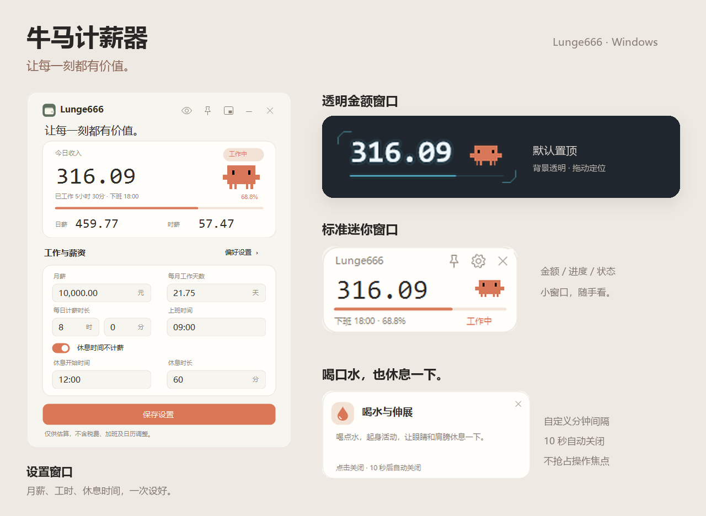
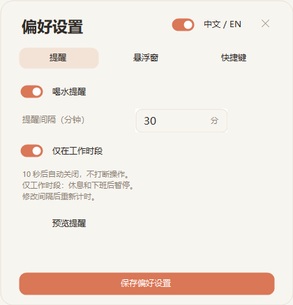

<div align="center">

# 牛马计薪器

### 让每一刻都有价值。

一个轻巧的 Windows 桌面计薪工具，把上班时间变成看得见的收入进度。

**[下载 Windows 版](https://github.com/Lun9e/niuma-salary-clock/releases/latest)** · **[使用方法](#开始使用)** · **[反馈问题](https://github.com/Lun9e/niuma-salary-clock/issues)**

中文 / English · 三种窗口 · 本地计算 · 无需安装

</div>



> 预览使用示例薪资与演示时间。软件窗口中的名称为 **Lunge666**。

## 它能做什么

| 功能 | 说明 |
| --- | --- |
| 实时计薪 | 按月薪、每月工作天数和每天有效工时，估算当前班次已赚金额。 |
| 三种窗口 | 设置窗口、标准迷你窗口、透明纯金额窗口，按使用场景切换。 |
| 独立置顶 | 纯金额窗口默认置顶，可单独取消；设置与迷你窗口共用图钉偏好。 |
| 喝水提醒 | 自定义 **1–1440 分钟**间隔，可选择仅工作时段提醒；右下角轻提示不抢焦点，10 秒后自动关闭。 |
| 休息暂停计薪 | 设置休息开始时间与时长，明确控制该时段金额是否暂停增长。 |
| 中英文切换 | 在偏好设置中即时切换中文 / English，重启后保留。 |
| 隐私显示 | 一键隐藏金额，方便共享屏幕或临时离开电脑。 |
| 位置记忆 | 记住三种窗口的位置和最后使用模式，兼容多显示器位置恢复。 |
| 单实例运行 | 重复打开时唤回已有窗口，避免桌面出现多个相同程序。 |

## 下载与运行

1. 打开 **[最新发布版本](https://github.com/Lun9e/niuma-salary-clock/releases/latest)**。
2. 展开 **Assets**，下载 `.exe` 文件，或名称带 **Windows** 的程序 ZIP 包。
3. ZIP 包先解压，再运行其中的主程序；直接下载的 EXE 可双击运行。

**普通使用者无需下载源码包。** GitHub 自动生成的 `Source code (zip)` / `Source code (tar.gz)` 是仓库内容，不是程序安装包。

| 运行环境 | 要求 |
| --- | --- |
| 系统 | Windows 10 1703 及以后、Windows 11，常见 Intel / AMD 电脑。 |
| 运行库 | .NET Framework 4.7 或更高版本，推荐 4.8。 |
| 已实测环境 | Windows 10 Enterprise LTSC 2021；100% / 150% 显示缩放与双显示器。 |

不需要安装 Python、Node.js 或额外软件包。其他 Windows 版本及硬件组合未逐一实机验证。

## 开始使用

1. 填写**月薪**、**每月工作天数**、**每日计薪时长**和**上班时间**。
2. 如果午休不计薪，开启 **“休息时间不计薪”**，填写休息开始时间和时长。
3. 点击 **“保存设置 / Save settings”**，金额按已保存的参数计算。
4. 打开 **“偏好设置 / Preferences”**，调整提醒、浮窗、语言和全局快捷键。

例如：**09:00 上班、每天有效计薪 8 小时、12:00 午休 60 分钟**，则下班时间为 **18:00**。开启休息暂停后，12:00–13:00 金额保持不变；关闭休息选项，8 小时班次会在 17:00 结束。

首次启动显示的薪资与工时只是默认示例，请换成自己的参数。

### 常用快捷键

| 快捷键 | 操作 |
| --- | --- |
| **Alt + Z** | 打开设置窗口 |
| **Alt + X** | 打开标准迷你窗口 |
| **Alt + C** | 打开透明纯金额窗口 |

三个快捷键均直接打开指定窗口，重复按下会保持窗口显示。可在 **偏好设置 → 快捷键** 中修改；若被其他软件占用，请换一组组合键。

- **拖动**浮窗可以移动位置，**双击**浮窗返回设置。
- **右键**纯金额窗口，可调整置顶、隐私、切换窗口或退出。
- 设置窗口的 **“−”** 隐藏到系统托盘；**“×”** 退出程序。

### 喝水提醒

在 **偏好设置 → 提醒** 中输入分钟数，点击保存后按新间隔重新计时，重启后保留。默认间隔为 **30 分钟**。

<p align="center">
  
</p>

开启 **“仅在工作时段”** 后，休息和下班时暂停，恢复工作后重新计时。提示在宿主窗口所在屏幕的**右下角**出现，避开任务栏，保留缩放后的边距；点击可以关闭，也会在 10 秒后自动消失。

## 金额如何计算

```text
日薪     = 月薪 ÷ 每月工作天数
时薪     = 日薪 ÷ 每日有效计薪小时数
本班已赚 = 时薪 × 本班已过去的有效计薪时长
```

上班前为 0，启用的休息时段暂停增长，下班后封顶为日薪。支持跨午夜班次与小数工作天数，显示金额保留两位小数。

这是一个**估算与展示工具**：不自动扣税，不处理奖金、考勤、加班费，也不会自动排除周末或节假日。修改参数并保存后，会重新估算当前整个班次的收入。

## 设置与隐私

所有计薪计算均在本机进行，程序没有联网操作。个人设置保存在当前 Windows 用户目录：

```text
%LOCALAPPDATA%\SalaryClock\settings.json
```

分享程序文件不会把你的薪资、窗口位置或个人快捷键一起发给别人。卸载时退出程序并删除 EXE 即可；如需清除个人设置，再删除上述配置目录。

## 常见问题

**为什么浮窗没有出现？**  
先按 Alt + C 或 Alt + X。也可以从系统托盘菜单打开；多显示器配置变化后，程序会尝试把窗口调整回可见工作区。

**纯金额窗口会盖住其他软件吗？**  
默认置顶。需要时在纯金额窗口的右键菜单中单独取消，这项选择会保存。

**程序打不开怎么办？**  
确认系统与运行库满足上面的要求，推荐使用 .NET Framework 4.8。反馈问题时请附系统版本、显示缩放和报错截图，并遮挡个人信息。

**电脑休眠或软件关闭后，金额会算错吗？**  
金额按电脑本地时间计算，不依赖程序持续运行。提醒在退出程序后停止；休眠恢复后只提示一次到期提醒，不连续弹出多条。

## 反馈与素材说明

- 问题与建议：[提交 Issue](https://github.com/Lun9e/niuma-salary-clock/issues)。
- 更详细的操作说明：[使用说明](使用说明.md)。
- 图标与角色来源：[素材来源](素材来源.md)。Clawd 角色及相关名称归 Anthropic 所有，本项目与 Anthropic 无关联。

---

<div align="center">

认真工作，也记得喝水。

</div>
